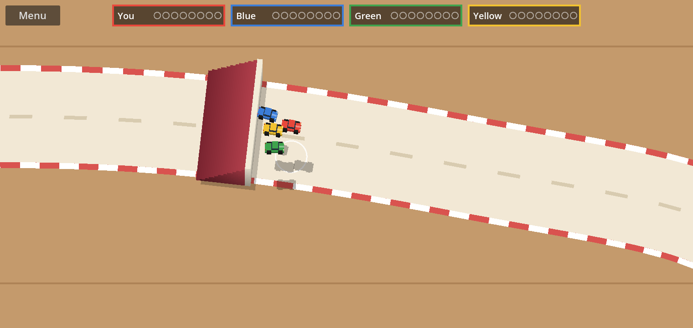
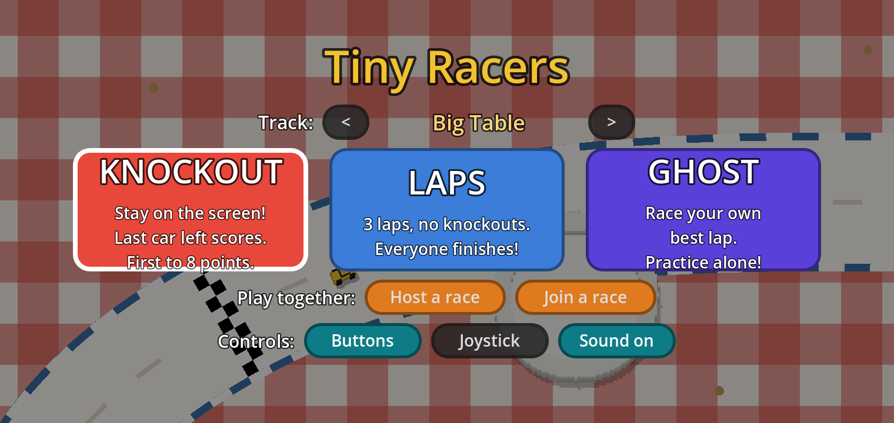
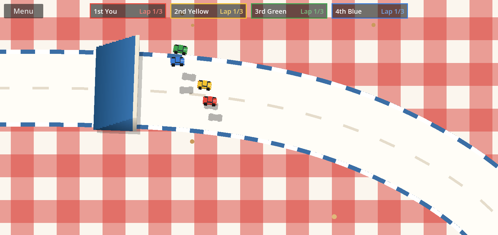
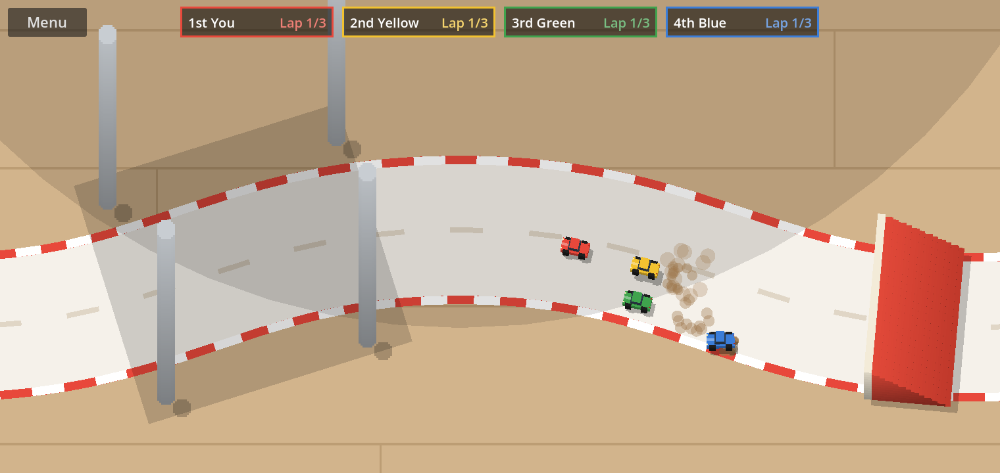
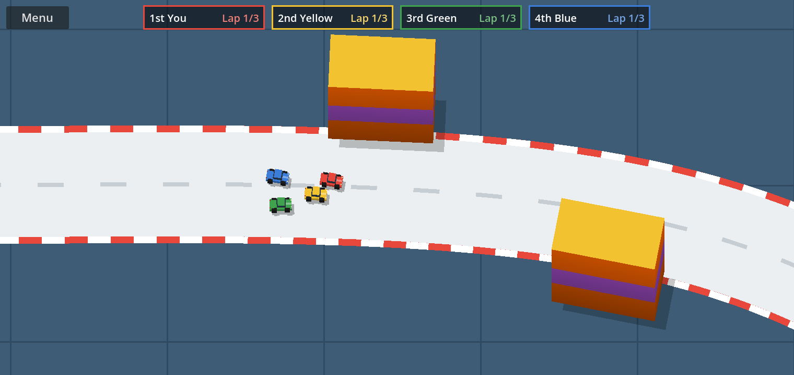
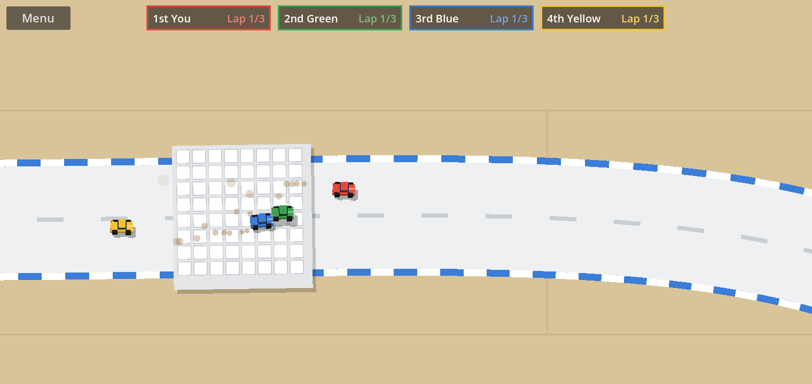
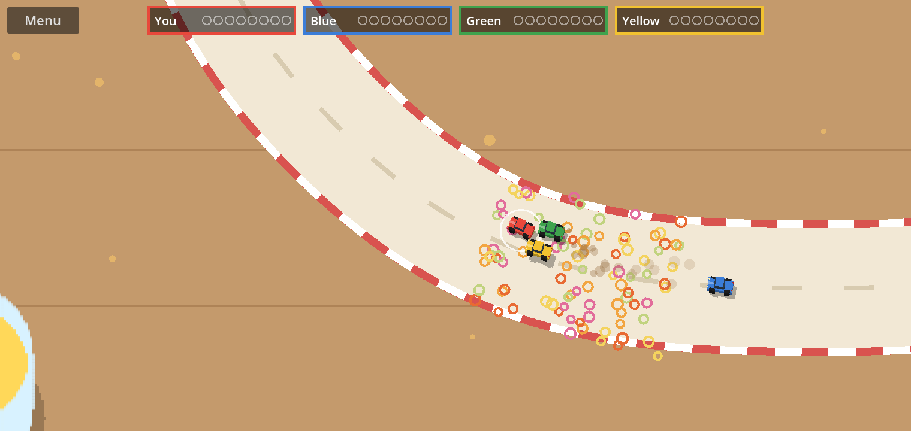
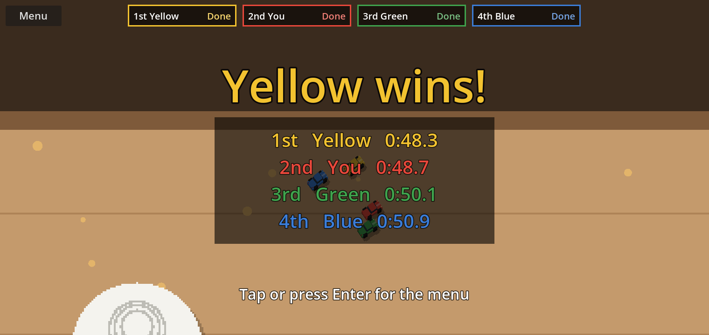
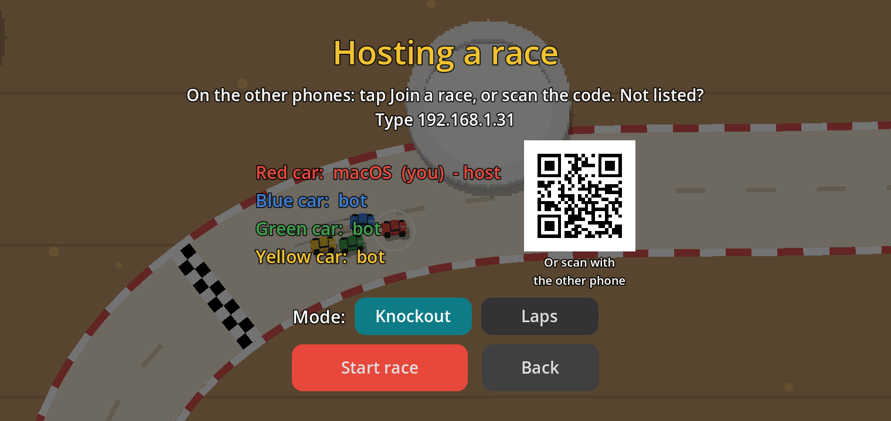
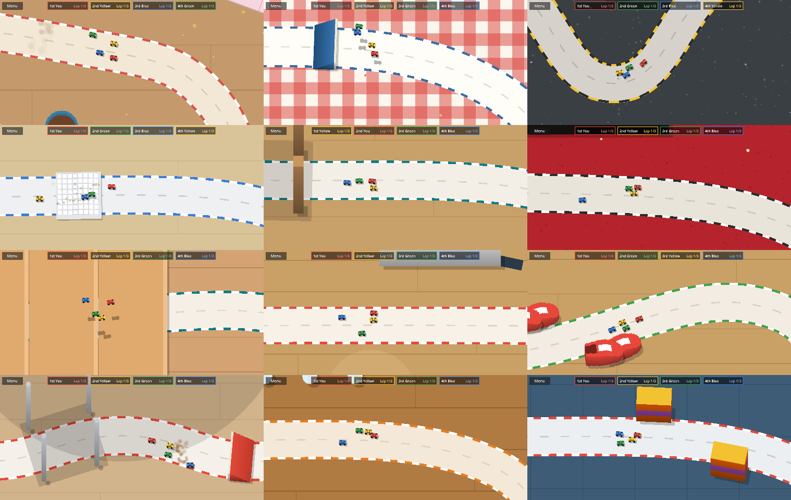

# Tiny Racers

A top-down tabletop racing game for Android: tiny cars racing across
tables, desks and floors around the house. 12 tracks. Race the bots, chase
your own ghost, or race each other on the same Wi-Fi with up to 4 phones.

**[Install Tiny Racers](https://daplein.github.io/apps/tiny-racers/)**: open
that page on your Android phone and tap *Download for Android*. Or scan this
with the phone's camera:

To share it from the game, tap **Share** on the start menu and let a friend
scan the code. The game also tells you when a new version is out.

| | |
|---|---|
|  |  |
|  |  |
|  |  |
|  |  |

## The 12 tracks

Kitchen Table, Big Table, Kitchen Worktop, Office Desk, Living Room, Cinema
Room, Stairs, Corridor, Shoe Rack, Round Table, Dresser and the Juggling
Mat. Pick one on the start menu with the arrows (when playing together, the
host picks).

## Install on Android

1. On the phone, open the [install page](https://daplein.github.io/apps/tiny-racers/),
   tap **Download for Android**, then tap the downloaded file.
2. When Android asks, allow your browser (or Files app) to
   **install unknown apps**.
3. Tap **Install**, then open **Tiny Racers**. It plays in landscape.

New versions install over the old one; your settings and best laps stay.

## How to play

- **Knockout:** the camera follows the leader. Fall off the screen and you're
  out; the last car left scores. First to 8 points wins.
- **Laps:** 3 laps, no knockouts, everyone finishes.
- **Ghost:** race alone against a see-through replay of your best lap
  (one best lap per track).

**Controls** (pick on the start menu):

- **Buttons:** the car drives itself. Hold the left half of the screen to
  steer left, the right half to steer right, both to brake or reverse.
- **Joystick:** drag anywhere. The car turns towards where you drag, and
  how far you drag sets the speed.

## Play together

All phones on the **same Wi-Fi**, up to 4 players (bots fill the rest).

1. One phone: **Host a race**, pick Knockout or Laps.
2. The others: **scan the QR code** on the host's screen with the camera and
   tap **Join the race**, or tap **Join a race** and pick the host from the
   list (or type the address the host shows).
3. The host taps **Start race**.

## Notes

- Android only (no iPhone version).
- Works without internet; playing together only needs the house Wi-Fi.
- The game collects no data and has no ads.

## Credits

Made with [Godot Engine](https://godotengine.org) (MIT licence).
Sound effects from [Epidemic Sound](https://www.epidemicsound.com), used
under licence. All other art and sounds are original.
